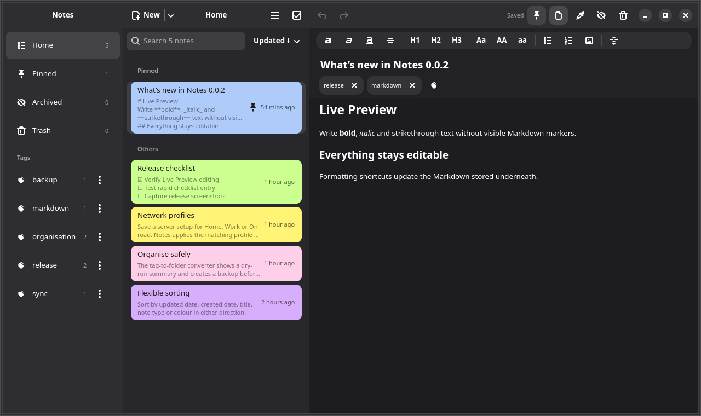
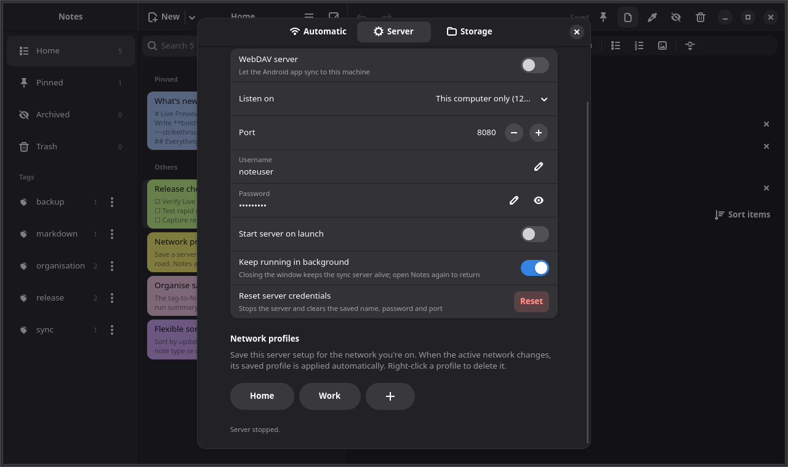
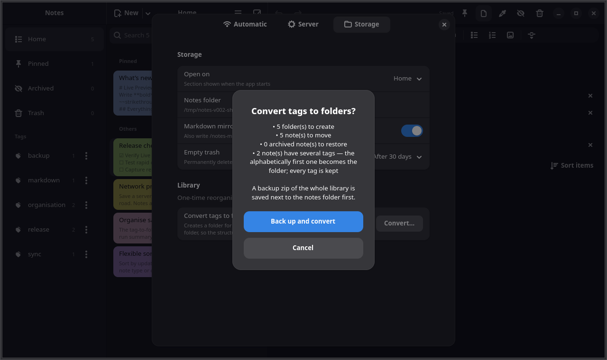
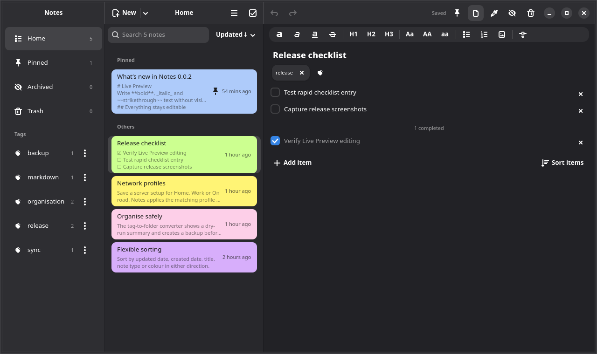

# Notes

A native GTK4 / libadwaita notes app for Linux with an embedded WebDAV sync
server for
[Simple Notes Sync](https://github.com/inventory69/simple-notes-sync) on
Android.

Notes is a port, not a wrapper. It reads and writes the same JSON and Markdown
format as the Android app, so the phone can sync directly with the desktop—no
Docker container or separate server required.



## What’s new in 0.0.2

- **Editable Live Preview:** Markdown headings and emphasis render with their
  markers hidden, while every edit is saved as Markdown underneath.
- **Network-aware sync:** save Home, Work or travel server profiles and let
  Notes apply the matching configuration automatically.
- **Background keep-alive:** close the window without stopping phone sync;
  launch Notes again to raise the same instance.
- **Safe library conversion:** review a dry run, create a backup, then convert
  tags into phone-visible folders. Notes already in a folder are left alone.
- **Flexible sorting:** sort notes by date, title, type or colour, and sort
  checklist items by state, alphabet or creation time.
- **Reliable checklists:** rapid item entry keeps every item and rows remain
  compact and visible.

| Network profiles and background sync | Safe tag-to-folder dry run |
|---|---|
|  |  |



See the complete release history in [CHANGELOG.md](CHANGELOG.md).

## Features

- Notes and checklists with autosave
- Markdown source editing, formatting toolbar and editable Live Preview
- Folders, tags, pinning, archive, trash and colour coding
- Full-text search and configurable sorting
- Multi-select move, pin, colour, archive and delete
- Google Keep and Markdown/Obsidian import
- Portable backup and restore
- Markdown mirror for external editors
- Embedded authenticated WebDAV server
- Per-network server profiles and optional background operation

Unknown JSON fields written by a newer Android build are preserved on
round-trip, preventing desktop edits from silently dropping mobile data.

## Install

Download `notes_0.0.2-1_amd64.deb` from the
[v0.0.2 release](https://github.com/kalotrapezis/Notes/releases/tag/v0.0.2),
then install it:

```bash
sudo apt install ./notes_0.0.2-1_amd64.deb
```

Open **Notes** from the application menu. The exact installed build appears
under **⋮ → About Notes**.

## Connect the Android app

1. Open **⋮ → Settings… → Server**.
2. Set a password and choose **All interfaces** so the phone can reach the
   computer.
3. Start the WebDAV server and copy its address, username and password.
4. Enter those details in the Android app under **Settings → Server**.

The server listens only on `127.0.0.1` by default. LAN access is opt-in.
Credentials are stored in `~/.config/Notes/config.json` with owner-only
permissions; the password is plaintext, so protect that file like any other
local credential.

## Data layout

```text
~/.local/share/Notes/
  notes/              <uuid>.json        master data
  notes/<Folder>/     <uuid>.json        folder contents
  notes-md/           <Title>.md         optional Markdown mirror
```

Use **Settings → Storage** to open the notes folder, choose the startup view,
configure trash retention, and manage one-time library conversions.

## Build from source

On Debian or Ubuntu:

```bash
sudo apt install build-essential pkg-config libgtk-4-dev \
  libadwaita-1-dev libgtksourceview-5-dev
cargo build --release
```

Run with:

```bash
cargo run --release
```

Build the Debian package:

```bash
cargo install cargo-deb
NOTES_BUILD_LABEL=0.0.2 cargo deb
```

## Current limitations

- Image/attachment sync is not yet implemented.
- Checklist drag-to-reorder is not yet implemented; the Sort menu provides
  deterministic ordering.
- Live Preview covers text notes, not checklist notes.

## Licence

AGPL-3.0-or-later, matching the upstream Android project.
